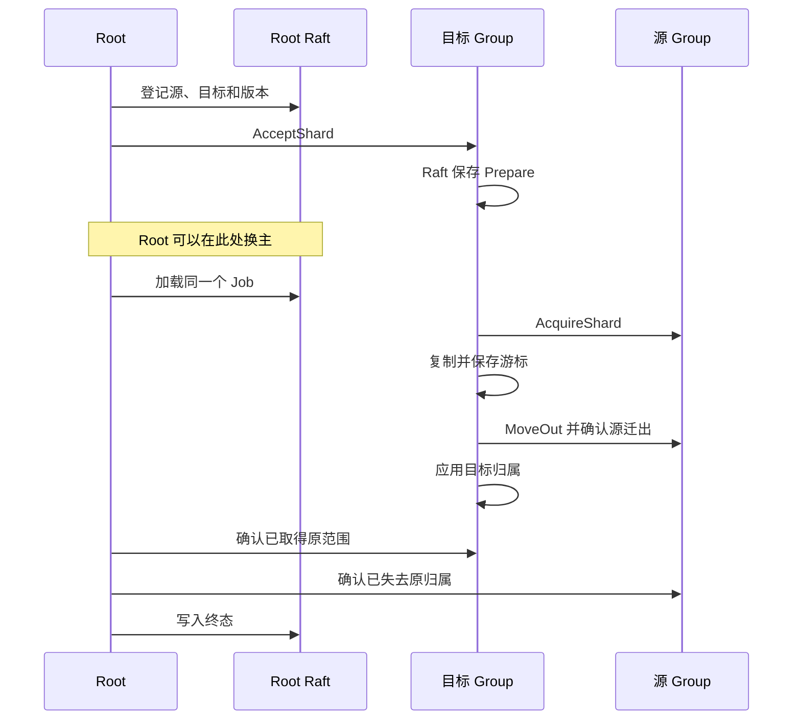

# Sekas Root 调度器设计

Root 根据集群拓扑和负载选择下一步放置动作。动作先登记到 Root Raft，再由执行侧推进。Group 的 Raft 已有 shard 归属、迁移进度和成员关系。Root 换主后读取原 Job 与这些业务状态，继续执行或确认完成。副本故障修复仍由各 Group 调度。


## 输入和接口

| 输入 | 含义 | 缺失或过期时 |
| --- | --- | --- |
| 节点描述、liveness、资源样本 | 节点状态及 CPU、内存、磁盘占用 | 停止向失联节点放置。缺资源样本时跳过依赖该样本的动作 |
| Group 描述、leader 报告 | 成员、shard 归属、leader 的 replica ID 和 term、在途迁移 | 跳过涉及该组的新迁移。已登记的动作可以询问当前 Group leader |
| Shard 字节和速率 | Group 大小由已知 shard 大小求和。速率来自同一 leader 任期内的连续样本 | 未采样的范围记为未知。已知没有 shard 的 Group 大小为零 |
| 活动 Job、建组进度和配置 | 本轮资源约束、预计供给、容量上限和负载优先级 | 新 Root 加载 Job 后才开始规划 |

每轮读取一次节点、Group 和副本状态，放置、drain 和 Job 登记共享解析出的 leader。若当前成员已经报告更高任期，即使还没观察到新 leader，旧报告也退出候选。Job 登记使用候选所依据的任期。统计可用于放置和等待，结束任务依据已提交的业务状态。每项 Job 同时只有一次本地推进，RPC 有超时，多项独立工作可并发。退避只保存在内存。换主会重置退避，并保留持久化动作参数和冲突约束。 [调度循环](../src/server/src/root/schedule.rs) · [采样快照](../src/server/src/root/stats/show.rs)

```text
Plan          PlacementJob | CreateGroup | Drained
PlacementJob  action (with its admission parameters), reason, created_at, outcome?
step          Pending | Prepared(action) | Finished(outcome)
InspectGroup  committed GroupDesc, leader ID, term, migration?
```

| 动作 | 首次登记与后续补齐的参数 | 资源约束 |
| --- | --- | --- |
| 迁 shard | 完整 shard 描述、两组 ID 和 epoch、目标任期 | 两组和目标组各 replica 节点的复制额度 |
| 转 leader | Group ID、原 leader、目标 voter、epoch 和 term | 本组 |
| 迁 replica | Group ID、源 replica 和目标节点。首次加入 learner 前保存 incoming ID 和原配置 epoch | 本组和目标节点的复制额度 |
| Split | 原 shard 和 epoch。查询分割点后，保存实际 key、新 shard ID 和提交任期 | 本组 |
| Merge | Group ID、原 epoch 和 term、左右两个 shard 描述 | 本组 |
| 建 group | `CreateOneGroupJob` 先保存完整成员分配，再按固定 ID 创建 | 未就绪的组只计入预计供给 |
| Drain | 节点状态中的持续意图。需要转 leader 时为每组生成一个动作 | 每项转移占用对应 Group |

`BackgroundJob` 存在 Root 的 `JOB_ID` 表中。登记用存在条件，修改用旧值条件。已达成、已取消和失败都由原行的一次条件写入结束。最新登记的 256 条已结束调度记录供诊断，后台定期清理。分配出的 ID 可以跳号，RPC 重放沿用已保存的 ID。 [Job 数据结构](../src/server/src/root/schedule/action.rs) · [Root 存储](../src/server/src/root/schema.rs)

## 自动均衡

按可执行的 drain、容量超限、负载超限、规划水位、常规负载偏差、启动所需的 Group 数、主动 split 或 merge 推进。每轮登记一个新动作。某项动作缺少前置条件时，独立的其它工作仍可继续。收益来自允许区间之外的偏差减少。常规 leader、replica 和 shard 数量用于观察，部署可以为它们显式配置上限。 [放置计算](../src/server/src/root/allocator/placement.rs)

| 目标 | 主要动作 |
| --- | --- |
| Group 容量回到水位内 | 迁完整 shard、按需 split、建 Group |
| Group 读写负载回到容忍区间 | 迁热点 shard。拆分后重新读取字节和流量再选目标 |
| 节点资源控制在上限内 | 转 leader 转移服务负载，迁 shard 转移数据，必要时迁 replica |
| 减少数据移动 | 同一负载目标内优先可行的 shard 动作。仅当轻量动作无法满足同等优先级目标时选择 replica |

候选必须满足 Group 的版本与健康条件、节点状态、冲突约束及目标容量。资源检查同时计算稳态变化和复制期间的峰值。在同一个目标下比较收益、是否需要 split、范围局部性和稳定 ID。不同负载维度按 `balancer.priority` 选择，在各自原单位计算。已失联节点缺少样本时，只等待确实经过它的资源检查。

### 容量和建组

Group 默认上限 `C = 100 GiB`，规划水位 `H = 0.8 × C`。按 Group 的一份数据估算容量，节点磁盘另按实际副本位置和复制峰值计算。`C` 和 `H` 都参与调度决策，前台写入仍按存储自身的准入规则运行。需要严格时间点上界时，约束应由写入端执行。

1. 在归属可判定的 Group 上求当前已知字节。若 `ceil(已知字节 / H)` 超过现有用户 Group 与在途可就绪 Group 的总数，登记一个建组 Job 后重算。暂时缺少报告的既有 Group 计入预期供给，等待其报告后才可接收新数据。
2. 没有可确认的总体缺口时，先选能放入已有目标的完整 shard，再考虑把一个 shard 拆成放得下的片。一次只承诺 split 或移动其中一个动作。两种动作都会触发下一轮重新观测。
3. 所有相关 Group 已具备可验证的容量、没有在途补充、现有空间仍放不下下一片数据时，可再建组。有正在复制的 Job 时，已占用 Group 不再接收新任务，目标节点也保留本次复制额度。

例如，`110 + 70 GiB` 的两组按 80 GiB 水位至少需要三组。`110 + 40 GiB` 且有一片可迁的 35 GiB 数据时，迁完仍使用两组，达到 `75 + 75 GiB`。数据、放置位置和 split 点都有足够证据后才执行相应动作。单一热 key 无法拆分时继续观察负载。

## 执行与恢复

`InspectGroup` 在当前 serving leader 上通过 ReadIndex 读取已提交的描述和在途迁移。迁副本时由 Group 调度器直接查询 Raft 追平进度。调度提交携带精确 epoch 和 term，路由改变不改写这两个参数。Group 的版本门槛约束迟到请求，已应用的副作用从成员、迁移阶段或范围确认。 [RPC 定义](../src/api/sekas/server/v1/node.proto) · [Group 执行](../src/server/src/replica/mod.rs)

| 观察结果 | 执行选择 |
| --- | --- |
| 当前范围、成员或选举已达到目标，且必须的收尾已结束 | 将 Job 标为完成 |
| Group 已持久化匹配的业务变更 | 观察 Group 收尾 |
| 目标仍满足原版本且动作适用 | 重放原请求 |
| 原版本失效，读到无匹配结果或在途变更 | 结束旧 Job，由后续规划按当前数据决定 |
| 暂时不可达或无法确认 | 相关 Job 带约束等待并退避 |

### 迁 shard

1. Root 在一次登记中保存 shard 描述、源目标 epoch 和目标 term。目标受理相同描述的重复请求时沿用当前迁移。
2. 目标 Group 的协调器用原源 epoch 执行 `AcquireShard`。源校验 epoch 和归属并持久化迁移。同任期内的冲突继续等。目标在 Prepare 时收到源的严格更高 epoch，才能安全清除迁移并推进自己的 epoch，以关闭迟到的接收请求。
3. 进入复制期后，已转发数据与游标一起保留。短暂失败时继续复制。目标提交之后驱动源迁出，确认源已应用并撤下旧归属，再应用目标归属。
4. Group 的 serving leader 随心跳报告完整迁移描述、阶段和身份。Root 遇到新鲜、匹配的迁移报告可继续等待。报告缺失、过期或结果仍未知时用 `InspectGroup`。目标已持有这一范围、源已移出且没有对应迁移时，条件写入成功结果。 [Group 迁移协调器](../src/server/src/node/move_shard/ctrl.rs) · [执行步骤](../src/server/src/root/schedule/execute.rs)



### 迁 replica

Root 保存固定 incoming ID 和首次加入时的 epoch。每轮读取 Group 当前已应用的成员关系，判断完成、取消，或提交一次推进请求。请求只确认入队，超时和换主后从同一份任务和成员关系继续。Group 调度器使用与自治修复共用的成员变更锁，从当前已应用的成员关系决定下一步。锁随 Group 换主重建，原 Job 可以继续推进。Root 停止推进 15 秒后锁到期，Group 仍可自行修复。发现 voter 失联时，尚未进入联合配置的迁移也会让出锁。

| 已提交的成员关系 | 下一步 |
| --- | --- |
| 源仍是 voter，incoming ID 尚未加入 | 按登记的配置 epoch 加入 learner，Raft 先占住该 ID |
| incoming 是 learner，尚未追平 | 用固定 ID 在目标节点幂等创建本地副本，等待 Raft 追平 |
| incoming 已追平，源仍是 voter | 若源是 leader 则先把 leadership 转给另一个 voter。随后提交替换 voter 的联合配置 |
| 已进入本次替换的联合配置 | 继续退出 joint，等待稳定配置 |
| incoming 成为 voter，源已降为 learner | 移除旧 learner，由 Group 原有孤儿清理回收副本 |
| incoming 是稳定 voter，源已退出 | 完成 |
| 源已被独立修复替换，或目标不再合适 | 收尾已进入的 joint。若只有 incoming learner 则移除它，再根据已提交配置结束或重新规划 |

只在 Raft 已加入 learner 之后创建本地副本。此顺序让每次恢复都能先判断 membership，再决定是否需要 Node RPC。副本是否追平由 Group 在提交替换前检查。 [Root 迁移意图](../src/server/src/root/schedule/execute.rs) · [Group 迁移执行](../src/server/src/schedule/tasks/group/migration.rs) · [Group 修复](../src/server/src/schedule/tasks/group/durable.rs)

### 转 leader、Shard 边界、建组

- **转 leader。** Root 从报告绑定原 leader 的 term 和 epoch，通过相同参数重试。目标当选时完成，其它新 leader 当选时原请求失效。Drain 先写入 `Draining`，为每个仍在该节点上的 leader 选择转移，确认全部转出后条件更新为 `Drained`。
- **Split 和 Merge。** Split 先获知分割点并保存固定的新 shard ID，生效条件是两个范围恰好覆盖原范围。Merge 首次登记绑定原范围及版本。成功时左 shard 覆盖合并范围且右 shard 消失。Group apply 推进 epoch，以阻止旧请求改动新范围。
- **建组。** 持久化成员分配后依次按固定 ID 创建。存储和路由观察到预期 voter 及 leader 后发布，未发布期间排除建表和新 shard 放置。回滚涉及所有已分配 ID，包括结果未知的创建。节点创建和删除互斥，删除留下持久化终止状态，以关闭迟到的创建。

## 观察与消融

`SHOW BALANCER` 展示最新候选、阈值和等待原因。`SHOW SCHEDULER_TASKS` 展示活动 Job、重试次数和本轮执行状态。任务历史保留终态原因。Node 故障后的调度范围取决于相关 Group 能否选出 serving leader，Root Raft 失去 quorum 时无法登记或结束 Job。

| 简化项 | 实际路径变化 | 验证场景 |
| --- | --- | --- |
| 单命令首次登记即绑定版本 | 迁 shard、转 leader、merge 首次发送前各少一次 Root Job 更新。无重试的迁 shard 路径上，Root 首次发出请求前的一致性读取由四次降为一次 | Root 换主后恢复同一条迁移，旧 leader 任期的请求被拒绝 |
| 从成员关系推导副本步骤 | 移除 Root 步骤枚举、已创建标志和回滚进度标志 | 自动迁 replica 从加入 learner 推进到替换完成 |
| 统一迁移观测 | 详细查询复用 `InspectGroup`，删除旧 Node 本地查询 | 重复受理、源或目标 leader 故障、转发写入、迁移回滚 |
| 共享放置样本 | 每轮读取一份 shard 样本快照 | 容量缺口、缺失报告隔离、对相关节点的在途复制限制 |
| 共享拓扑和 leader 解析 | 分配时按需读取元数据。分配 replica 从三类元数据读取降到一类，建表选组降到两类。动作执行后复用 `InspectGroup` 安排心跳 | 旧报告失效时选择健康目标，目标恢复报告后重新纳入候选 |

均衡效果可用超限 Group 数与超额字节、达到目标所需时间、迁出字节量和迁 replica 次数评估。上述路径对比计数为控制面操作数。生产吞吐和尾延迟要在实际规模下另行测量。 [分配器测试](../src/server/src/root/allocator/sim_test.rs) · [集成测试](../src/server/tests/test_admin.rs) · [迁移测试](../src/server/tests/test_move_shard.rs)

### 用最小迁移分片检验变更成本

自动 split 为大 shard 创造可迁移范围，之后的自动 merge 可以合并相邻的小范围。代码历史中的 `eb3989f` 引入了这组动作，`b6ada81` 增加了按大小均衡。一个有依据的后续决定是，为了避免少量收益触发复制，为**本次迁移新切出的部分**设最小尺寸。已能完整迁移的小 shard 仍可移动，主动 split 继续服务它原本的目标。

| 检查方向 | 本轮改动 |
| --- | --- |
| 变更放大 | 容量修复、常规大小均衡和碎片化导致的建组兜底共用 `movable_bytes`。改变最小分片门槛只改这处业务判断 |
| 信息隐藏 | 容量路径提出希望腾出的字节数，大小均衡提出源目标大小差的一半。`ShardTarget` 保存可用目标及其迁入额度，裁剪后将 split 字节数写入同一个 shard 候选，评分、展示和 Job 登记据此取值 |
| 隐藏依赖 | 枚举候选前一次读取成员变更和 split 冷却状态，并筛出本轮可迁入的目标。读到的状态影响本轮选择，RPC 提交时仍由 Group 校验版本 |
| 变更阻力 | 删掉候选生成后重复的资格判定，以及测试专用的候选复查入口。用容量和常规均衡入口验证同一组输入 |

修改这条规则时，维护者需要知道 shard 的已知字节数、目标水位剩余空间、单次迁移上限、源 shard 的拆分许可和冷却状态，以及各目标提出的拆分字节数。实现固定门槛时，改 `movable_bytes` 并验证这三个场景。若将门槛开放为部署配置，再增加配置字段、默认值和传递该值的入口。已知总量证明的容量缺口另行判断。针对空间碎片的建组兜底先验证假想空组能接收至少一个合法迁移。 [迁入额度与可搬字节](../src/server/src/root/allocator/placement.rs)

实验中暂设最小分片为 25 B，给两个 Group 分别输入 110 B 和 40 B 的数据。修改前，仅在容量路径加门槛，常规大小均衡仍选择 24 B。收拢后，仅在 `movable_bytes` 加同一门槛，两条路径都接受 25 B、拒绝 24 B，35 B 的完整迁移仍可选。实验结束后恢复原门槛，保留单次迁移上限切换的回归，以及零额度时碎片兜底不会误建组的检查。 [模拟用例](../src/server/src/root/allocator/sim_test.rs)
